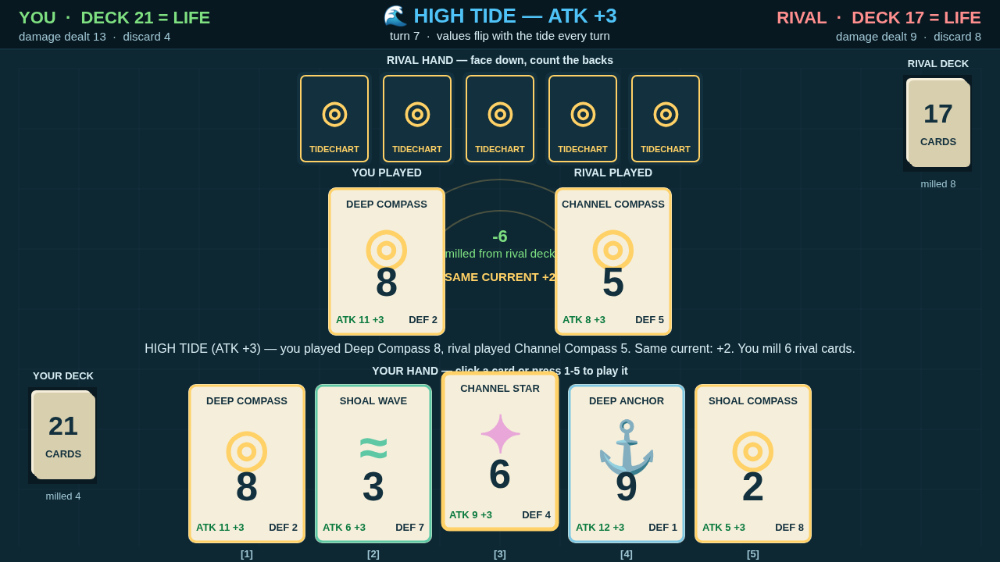

# TIDECHART DUEL — your deck is your life: 30 cards, values flip with the tide every turn, empty the rival deck to win

[](https://make.fun/bounty/best-card-game-20261122-1826?utm_source=github&utm_medium=readme&utm_campaign=best-card-game-20261122-1826)
[](https://make.fun/bounty/best-card-game-20261122-1826/leaderboard?utm_source=github&utm_medium=readme&utm_campaign=best-card-game-20261122-1826)
[](https://make.fun/bounty/best-card-game-20261122-1826?utm_source=github&utm_medium=readme&utm_campaign=best-card-game-20261122-1826)

A 1v1 card duel for make.fun's **best-card-game-20261122-1826** ($50, judge:
image). Two cartographers duel in a harbour at dusk, mapping a sea that
changes every turn. No fire, no embers — the sea is the enemy, and your chart
is your life.



## The one mechanic: your deck IS your life

- **30 cards each, and the deck is the life total.** Damage does not hit a
  health bar — it **mills** cards off the top of the other deck into the
  discard pile. **Empty deck loses.** Both deck piles are drawn on the table
  with their count in big numbers, because the count is the game.
- **Draw 1 every turn** — drawing mills your own deck by 1, so even a quiet
  game runs dry in ~25 turns. Attack, or be outlasted.

## The tide flips the values every turn

- **HIGH TIDE: ATK +3. LOW TIDE: DEF +3.** Every card carries ATK = its value
  (1–9) and DEF = 10 − value, so a heavy card hits hard but blocks badly and
  a light card is the opposite — and the tide decides which half matters.
  The banner across the top of the table shows the current tide in big type,
  and each card prints its tide-boosted values in green.
- **SAME CURRENT +2:** play the rival's suit and the higher attack mills 2
  more cards. Suit matters, not just numbers.

## A turn, in one line

You play a card, the rival answers with its best reply (it maximises
damage dealt minus damage taken), both blows land at once, the milled cards
fly to the discard piles, you both draw 1, and the tide flips.

## The rival AI

A deterministic heuristic, not a random pick: for every card in its hand it
scores (damage it would deal − damage it would take) against your played
card under the current tide, and plays the best one. It punishes a weak
block and it takes the +2 same-current bonus when it can.

## Controls

- **Click a card** or press **1–5** to play it · **← / →** move the selection,
  **Enter** plays the selected card
- **Space** — start · **P / Esc** — pause · **R** — restart after a win or a loss

## Sound

Synthesised in code with WebAudio (no audio files): a card snap, a low mill
rumble when cards leave a deck, a win fanfare and a loss sting.

## Play it

```sh
node serve.ts        # then open http://localhost:8080
```

No network request, no build step: `game/index.html` plus its ES modules
under `game/src/` (one job per file — `config.js` numbers, `deck.js` the
30-card chart, `world.js` the rules and AI, `render.js` the table,
`input.js` keyboard + mouse, `shots.js` the four screenshot scenes,
`audio.js` the sounds).

## Screenshots (real renders of this code)

1. `01-title.png` — title screen with the four rules
2. `02-table.png` — mid-game table: both hands, both deck piles as life
   totals, HIGH TIDE banner, the played pair, −6 milled, SAME CURRENT +2
3. `03-win.png` — win screen: rival deck milled to 0
4. `04-loss.png` — loss screen: your deck ran dry
